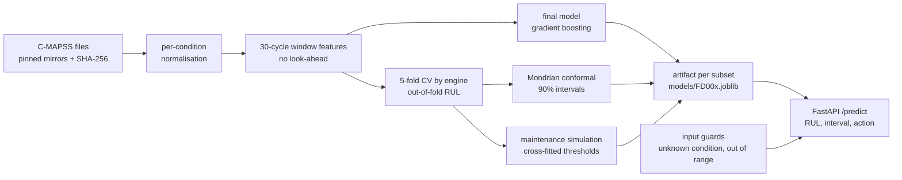
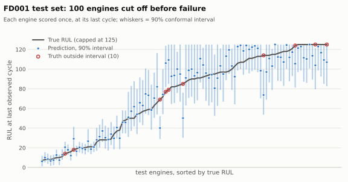
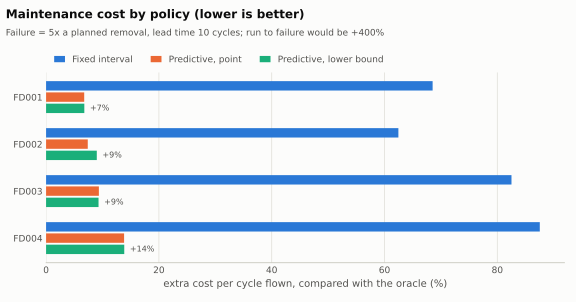
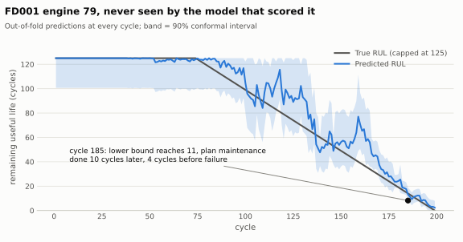
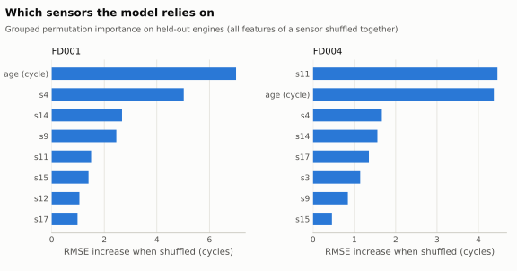

# Predictive maintenance: from turbofan sensor data to maintenance decisions

[](https://github.com/Mohamed-jarboui/P1/actions/workflows/ci.yml)

Predicts how many flight cycles a turbofan engine has left (remaining useful life, RUL) from its
sensor history, attaches a calibrated 90% interval, and turns that into a maintenance decision.
The headline result is not the RMSE: it is **how much a predictive policy costs compared with a
fixed maintenance schedule and with an oracle that knows the failure cycle**, measured on
engines the model never saw.

Data: NASA C-MAPSS, the standard run-to-failure benchmark (4 subsets, 709 training and 707 test
engines, 1 or 6 operating conditions, 1 or 2 fault modes). Everything runs on a CPU, no GPU:
`make all` downloads the data, trains, evaluates and rewrites the tables below in about 6 minutes
on a 4-core machine.

<!-- results:headline -->
- **Test RMSE (cycles):** FD001 11.8, FD002 12.9, FD003 12.1, FD004 13.2.
- **90% intervals, measured coverage on the test sets:** FD001 0.90, FD002 0.90, FD003 0.87, FD004 0.88.
- **Maintenance cost above the oracle, predictive policy vs best fixed interval** (failure = 5x planned, lead time 10 cycles): FD001: +7% vs +69% (1 vs 3 failures in 100 engines); FD002: +9% vs +62% (2 vs 7 failures in 260 engines); FD003: +9% vs +83% (1 vs 2 failures in 100 engines); FD004: +14% vs +88% (1 vs 6 failures in 249 engines).
<!-- /results:headline -->

The summary above and every results table below are generated from `results/*.json` by
`rul report` and never edited by hand. Sample sizes are given with each table.

## How it works



1. **Normalise per operating condition.** In FD002/FD004 the flight condition changes every
   cycle and moves the raw sensors far more than wear does. The six conditions are recovered
   from the settings and each sensor is z-scored within its own condition.
2. **Window features.** For each sensor: current value, 30-cycle mean, standard deviation,
   slope and an exponentially weighted mean. A test checks that features never use future cycles.
3. **Validate by engine.** 5-fold cross-validation grouped by engine, with preprocessing refitted
   in each fold. A row-wise split would leak: cycles of one engine on both sides.
4. **Calibrate.** Split conformal on the out-of-fold residuals, with separate quantiles per band
   of predicted RUL (errors are larger mid-life than near failure). Coverage is then measured on
   the official test sets.
5. **Decide.** Plan maintenance when the interval's lower bound reaches a threshold; the work is
   done 10 cycles later. A failure before that is an unplanned removal. Policies are compared by
   cost per cycle flown, with thresholds tuned on 4 folds of engines and scored on the 5th.
6. **Guard.** The API refuses to give a confident answer for inputs from an operating condition
   it never saw or with sensors far outside the training range.

Design notes and the alternatives not taken: [docs/design.md](docs/design.md).
Model card: [docs/model-card.md](docs/model-card.md). Data card: [docs/data-card.md](docs/data-card.md).

## Results

### 1. Prediction accuracy

Each test engine is scored once, at its last observed cycle. Benchmark of all models (fitted on
all training engines of the subset):

<!-- results:benchmark -->
| Test RMSE, cycles (lower is better) | FD001 | FD002 | FD003 | FD004 |
|---|---|---|---|---|
| `mean` (predicts the mean training label) | 41.94 | 44.93 | 43.70 | 45.57 |
| `ridge_current` (ridge on current sensor values) | 21.32 | 20.11 | 20.55 | 24.10 |
| `ridge_window` (ridge on 30-cycle features) | 15.69 | 16.20 | 16.27 | 19.27 |
| `hgb_window` (gradient boosting on 30-cycle features) | 11.85 | 12.92 | 12.12 | 13.21 |

Test engines per subset: 100 / 259 / 100 / 248. True RUL capped at 125 like the labels.
<!-- /results:benchmark -->

The main model (`hgb_window`) in more detail. The NASA score is the asymmetric score of the
PHM08 challenge: late predictions (more life predicted than left) cost more than early ones.

<!-- results:main -->
| Subset | RMSE | RMSE (uncapped truth) | MAE | NASA score | Late predictions | Test engines | CV RMSE (all cycles, by engine) | Test engines with > 125 cycles left |
|---|---|---|---|---|---|---|---|---|
| FD001 | 11.85 | 13.11 | 8.75 | 206 | 55% | 100 | 12.21 | 11% |
| FD002 | 12.92 | 25.57 | 9.24 | 759 | 42% | 259 | 13.80 | 22% |
| FD003 | 12.12 | 13.71 | 8.40 | 252 | 55% | 100 | 10.46 | 15% |
| FD004 | 13.21 | 25.68 | 8.97 | 769 | 48% | 248 | 13.64 | 27% |
<!-- /results:main -->

**Read the capped RMSE with care.** Like most C-MAPSS papers, the main RMSE compares against the
true RUL capped at 125, the same cap as the labels. Where many test engines have more than 125
cycles left (last column), the uncapped RMSE is much higher: on FD002 and FD004 it roughly
doubles, because the model cannot tell an engine with 125 cycles left from one with 190. Both
numbers are reported; compare with a paper only under the same convention.

For context only: the widely cited deep CNN of Li, Ding and Sun (2018, *Reliability Engineering
and System Safety*) reports an RMSE of 12.61 on FD001. That number is from the paper, not re-run
here, and protocols differ between papers (window length, normalisation, capping), so treat the
comparison as indicative. The point of this project is the decision layer below, not a
leaderboard position.

<picture>
  <source media="(prefers-color-scheme: dark)" srcset="docs/figs/test_fd001-dark.svg">
  
</picture>

### 2. Calibrated intervals

Target: 90% of test engines inside their interval, and the lower bound (the number the
maintenance policy uses) below the truth for 95% of them.

<!-- results:conformal -->
| Subset | Interval coverage (target 0.90) | Lower bound holds (target 0.95) | Mean width, cycles | Test engines |
|---|---|---|---|---|
| FD001 | 0.90 | 0.96 | 34.6 | 100 |
| FD002 | 0.90 | 0.94 | 36.6 | 259 |
| FD003 | 0.87 | 0.92 | 31.3 | 100 |
| FD004 | 0.88 | 0.93 | 36.6 | 248 |
<!-- /results:conformal -->

Sampling noise is large at this size: with 100 test engines the 95% binomial range around a true
coverage of 0.90 is about ±0.06, with 250 engines about ±0.04. The two-sided coverage is within
that range everywhere. The lower bound falls a little short of its 0.95 target in three of the
four subsets, so it is slightly optimistic; the calibration residuals come from every cycle of
the training engines, which are correlated within an engine (see Limitations).

### 3. Maintenance decisions

Simulated on the out-of-fold predictions of the training engines (the only ones that run to
failure; test engines are cut off before it).

<!-- results:maintenance -->
| Policy | FD001 | FD002 | FD003 | FD004 |
|---|---|---|---|---|
| Run to failure | 5.00x · 100/100 failed · 0 unused | 5.00x · 260/260 failed · 0 unused | 5.00x · 100/100 failed · 0 unused | 5.00x · 249/249 failed · 0 unused |
| Fixed interval (best age, tuned) | 1.69x · 3/100 failed · 71 unused | 1.62x · 7/260 failed · 68 unused | 1.83x · 2/100 failed · 103 unused | 1.88x · 6/249 failed · 105 unused |
| Predictive, point RUL (tuned threshold) | 1.07x · 1/100 failed · 5 unused | 1.07x · 1/260 failed · 11 unused | 1.09x · 1/100 failed · 12 unused | 1.14x · 1/249 failed · 27 unused |
| Predictive, conformal lower bound (tuned threshold) | 1.07x · 1/100 failed · 5 unused | 1.09x · 2/260 failed · 11 unused | 1.09x · 1/100 failed · 12 unused | 1.14x · 1/249 failed · 27 unused |
| Oracle (knows the failure cycle) | 1.00x · 0/100 failed · 0 unused | 1.00x · 0/260 failed · 0 unused | 1.00x · 0/100 failed · 0 unused | 1.00x · 0/249 failed · 0 unused |

Cost of a failure = 5 x a planned removal; lead time 10 cycles. Cell: cost per cycle flown relative to the oracle · engines that failed before maintenance · mean cycles of life thrown away per planned removal. Thresholds tuned on 4 folds of engines, scored on the 5th.
<!-- /results:maintenance -->

<picture>
  <source media="(prefers-color-scheme: dark)" srcset="docs/figs/policies-dark.svg">
  
</picture>

What this shows:

- In every subset the predictive policies sit much closer to the oracle than the best fixed
  interval, with fewer failures, because the fixed interval has to be short enough for the
  shortest-lived engines and so throws away a lot of life on the others.
- Point prediction and lower bound give almost the same cost at the default settings: once the
  threshold is tuned, it absorbs the safety margin the bound adds. The bound clearly helped in
  one setting only (FD002 with failures at 10x and 20x, next table). Its main value is in the
  API, where it states the risk in cycles instead of a bare number.
- The multi-condition, two-fault subset (FD004) is the hardest: more life is thrown away per
  planned removal, because the predictions are less precise there.

How the comparison moves with the cost of a failure:

<!-- results:cost_ratio -->
| Subset | failure = 2 x planned | failure = 5 x planned | failure = 10 x planned | failure = 20 x planned |
|---|---|---|---|---|
| FD001 | 1.46x / 1.04x / 1.04x | 1.69x / 1.07x / 1.07x | 1.74x / 1.12x / 1.12x | 1.90x / 1.22x / 1.22x |
| FD002 | 1.47x / 1.05x / 1.05x | 1.62x / 1.07x / 1.09x | 1.67x / 1.09x / 1.07x | 1.73x / 1.13x / 1.07x |
| FD003 | 1.63x / 1.07x / 1.07x | 1.83x / 1.09x / 1.09x | 1.99x / 1.15x / 1.15x | 2.33x / 1.25x / 1.25x |
| FD004 | 1.70x / 1.11x / 1.12x | 1.88x / 1.14x / 1.14x | 2.12x / 1.16x / 1.16x | 2.06x / 1.21x / 1.21x |

Cell: fixed interval / predictive (point) / predictive (lower bound), cost per cycle flown relative to the oracle; lead time 10 cycles.
<!-- /results:cost_ratio -->

One engine's life, scored by a model that never saw it:

<picture>
  <source media="(prefers-color-scheme: dark)" srcset="docs/figs/engine-dark.svg">
  
</picture>

### 4. Guards: what happens on data from another fleet

Each subset's model applied to every test set. Off the diagonal the model sees operating
conditions or fault modes it was not trained on.

What this shows:

- **Unknown operating conditions are always caught.** A single-condition model (FD001, FD003)
  fed six-condition data flags every engine; its error there is three to four times its error
  on its own test set.
- **A new fault mode is only partly caught.** FD003 data (fan and HPC faults) into the FD001
  model (HPC only) raises the error by about 2x, but the out-of-range guard flags well under
  half of those engines.
- **PSI measures change, not harm.** Three of the four models' own test sets show a PSI above
  the usual 0.25 alarm on some sensor, because test engines are cut off before failure and look
  healthier than the training data. The FD004 model on FD001 data has the highest PSI in the
  table, yet its error stays moderate. That is why the per-request guards check "outside what
  the model knows", not "different from the training average".
- Training on the broadest data (FD004: all conditions, both faults) gives a model that works
  reasonably on every subset.

<!-- results:cross -->
|  | test FD001 | test FD002 | test FD003 | test FD004 |
|---|---|---|---|---|
| model FD001 | 11.8 · 0% · 0.35 | 35.6 · 100% · 4.63 | 25.4 · 38% · 1.32 | 39.6 · 100% · 5.10 |
| model FD002 | 13.9 · 0% · 3.98 | 12.9 · 0% · 0.19 | 23.6 · 39% · 4.27 | 23.1 · 38% · 1.10 |
| model FD003 | 11.9 · 0% · 2.75 | 48.4 · 100% · 5.51 | 12.1 · 0% · 0.30 | 47.2 · 100% · 4.80 |
| model FD004 | 17.0 · 0% · 8.02 | 13.4 · 0% · 2.52 | 13.8 · 1% · 4.41 | 13.2 · 1% · 0.29 |

Cell: test RMSE · share of test engines the input guards flag as unreliable · largest population stability index (PSI) over the sensors, test set vs training data.
<!-- /results:cross -->

### 5. What the model looks at

<!-- results:importance -->
| Subset | Top 5 inputs by RMSE increase when shuffled |
|---|---|
| FD001 | cycle (+7.0), s4 (+5.0), s14 (+2.7), s9 (+2.5), s11 (+1.5) |
| FD002 | cycle (+7.1), s11 (+5.9), s4 (+3.6), s15 (+1.6), s2 (+1.2) |
| FD003 | s11 (+5.7), cycle (+4.8), s9 (+3.8), s3 (+3.4), s12 (+2.2) |
| FD004 | s11 (+4.5), cycle (+4.4), s4 (+1.7), s14 (+1.6), s17 (+1.4) |
<!-- /results:importance -->

<picture>
  <source media="(prefers-color-scheme: dark)" srcset="docs/figs/importance-dark.svg">
  
</picture>

Sensor names (from Saxena et al., 2008) are in `src/rul/config.py`, e.g. s11 = static pressure
at the HPC outlet, s4 = temperature at the LPT outlet, s9 = core speed. Engine age (`cycle`)
ranks high because C-MAPSS engines have similar lifetimes; in a real fleet with mixed usage, age
would say less, and this is one of the first things to recheck on field data.

## Run it

Requires [uv](https://docs.astral.sh/uv/) (it installs Python 3.12 if missing).

```bash
make install    # uv sync
make test       # tests on synthetic engines, no network, a few seconds
make all        # download + train + evaluate + simulate + drift + README tables + figures
make serve      # API on http://127.0.0.1:8000 (interactive docs at /docs)
```

The steps one by one: `uv run rul download | train | evaluate | simulate | drift | report`.
Score one engine from a C-MAPSS file without the API:

```bash
uv run rul predict --subset FD001 --file data/raw/test_FD001.txt --unit 1
```

### Docker

The image is self-contained: the build downloads the data (hash-checked), trains the four models
and serves them.

```bash
docker build -t rul-api .
docker run --rm -p 8000:8000 rul-api
```

### API

```bash
curl -s -X POST http://127.0.0.1:8000/predict \
  -H 'content-type: application/json' -d @examples/predict_FD001_unit1.json
```

The request holds one engine's history, oldest cycle first (3 settings and 21 sensors per cycle).
The example is FD001 test engine 1 (31 cycles; its true RUL, from `RUL_FD001.txt`, is 112).
Response from a local run:

```json
{
  "subset": "FD001",
  "cycles_seen": 31,
  "rul": 123.65,
  "interval": {"low": 99.33, "high": 125.0, "level": 0.9},
  "action": "continue_operation",
  "reasons": [],
  "guards": {"reliable": true, "unknown_condition_rate": 0.0, "out_of_range_rate": 0.0,
             "max_condition_distance": 0.01, "reasons": []},
  "model_version": "0.1.0"
}
```

`action` is `continue_operation`, `schedule_maintenance` (the lower bound reached the policy
threshold) or `inspect_manually` (the guards fired; `reasons` says why). Other endpoints:
`GET /health`, `GET /models/{subset}` (model card: calibration, policy, sensors used), and the
interactive docs at `/docs`.

## Project layout

```text
src/rul/
  data.py          download (pinned mirrors, SHA-256), parsing, labels
  preprocess.py    operating conditions, sensor selection, per-condition z-scores
  features.py      window features, no look-ahead
  models.py        the compared regressors
  pipeline.py      out-of-fold CV by engine, final fit, the saved artifact
  conformal.py     Mondrian split conformal intervals
  maintenance.py   policies, cost rate, cross-fitted threshold tuning
  monitoring.py    input guards and PSI
  experiments.py   the experiments behind every table
  report.py        README tables from results/*.json
  api.py           FastAPI service
  cli.py           `rul` command
tests/             synthetic engines (conftest.py), no network
results/           experiment outputs, committed
scripts/           figures, example request
```

CI (`.github/workflows/ci.yml`) runs lint and tests on every push. The manual **Pipeline**
workflow runs `make all` on the real data, uploads results and models, and builds and smoke-tests
the Docker image.

## Limitations

- **Simulated data.** C-MAPSS comes from an engine simulator with a few fault modes and no
  missing data. Nothing here is validated on a real fleet.
- **Assumed costs.** The failure/planned cost ratio and the lead time are assumptions; the tables
  show how the conclusion moves with them, not what an operator would save.
- **The cap.** RUL above 125 cycles is reported as 125: the model cannot tell a healthy engine
  with 150 cycles left from one with 300.
- **Correlated calibration data.** Conformal residuals come from every cycle of the training
  engines, which are correlated within an engine; coverage is therefore measured, not guaranteed.
- **Guards are simple.** They catch unknown operating conditions; a new fault mode under known
  conditions (FD003 data into the FD001 model) is only partly caught.

## Data and citation

A. Saxena, K. Goebel, D. Simon, N. Eklund, "Damage propagation modeling for aircraft engine
run-to-failure simulation", PHM08, 2008. Data from the NASA Prognostics Center of Excellence data
repository. Code: MIT licence.
